# The diagram catalog

Generated by `prs catalog --stills` from `catalog/*.js`; every still is the treatment's own demo, from a made-up PR.
Use them to see what a treatment looks like, never as content to reuse.

## title: the fixed opening frame (always the first beat)

### `title.frame`: Title frame

Always the first beat. Fixed design: PR number, your short headline, the PR title, author, state, and a per-file "What changes" card.

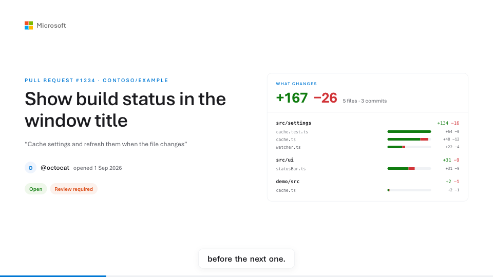

| param | what |
| --- | --- |
| `headline` | label: what the PR does in 4-8 plain words (not the PR title) |
| `at` | { author, stats, state }: times; default to the cues of the same names |

## concept: a problem, a mismatch or a few ideas side by side

### `concept.mismatch`: Have vs need

The problem is a mismatch: what something is vs what is required (a token, a format, a permission, a version).

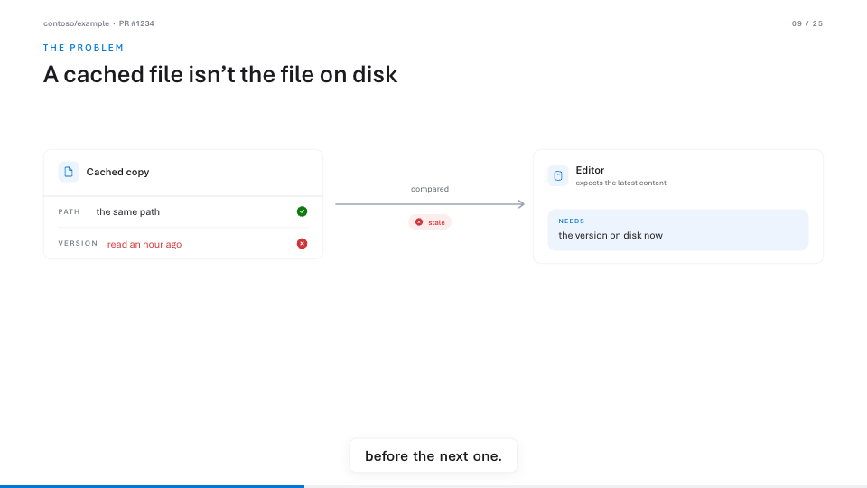

| param | what |
| --- | --- |
| `eyebrow` | label |
| `title` | label |
| `have` | { icon, title, rows: [{ key, value, ok, at }] }  (2-3 rows) |
| `link` | { label, verdict: { text, tone }, at } |
| `need` | { icon, title, sub, tone, requirement: { label, text }, at } |
| `footer` | { lead, note, at, items: [{ icon, title, mono, label, value, sub, chip, tone, at }] }  (optional, 1-4 items) |

### `concept.pillars`: Numbered pillars

Two to four ideas, parts or reasons of equal weight ("three things change").

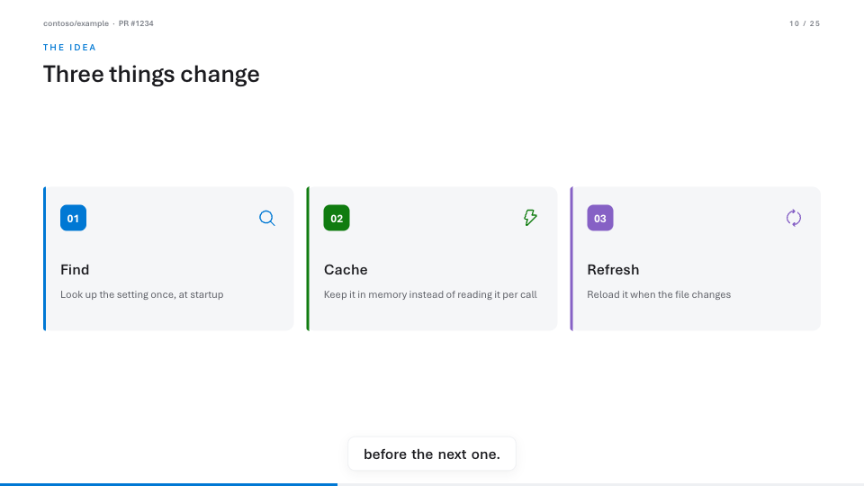

| param | what |
| --- | --- |
| `eyebrow` | label |
| `title` | label |
| `items` | [{ icon, title, text, code, at }]  (2-4) |

### `concept.statement`: Statement

The point fits in one sentence ("the bug: X happens because Y"). Good for small PRs and for the problem beat.

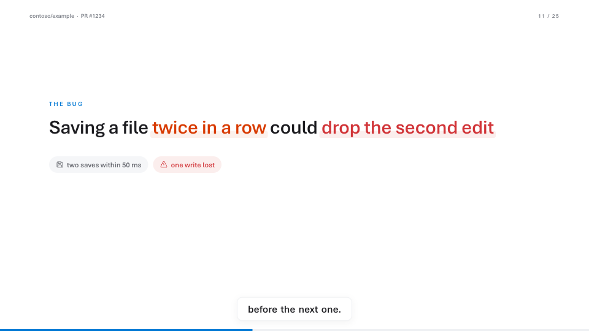

| param | what |
| --- | --- |
| `eyebrow` | label |
| `parts` | [text \| { text, mark: tone, at }]  (the sentence; marked parts highlight at their time) |
| `chips` | [{ icon, text, tone, at }]  (0-4) |

## exchange: messages between parties: a protocol, a handshake, a request and its reply

### `exchange.journey`: Packet journey

One request or value moving through 3-5 places, where what happens at each stop matters more than strict call order.

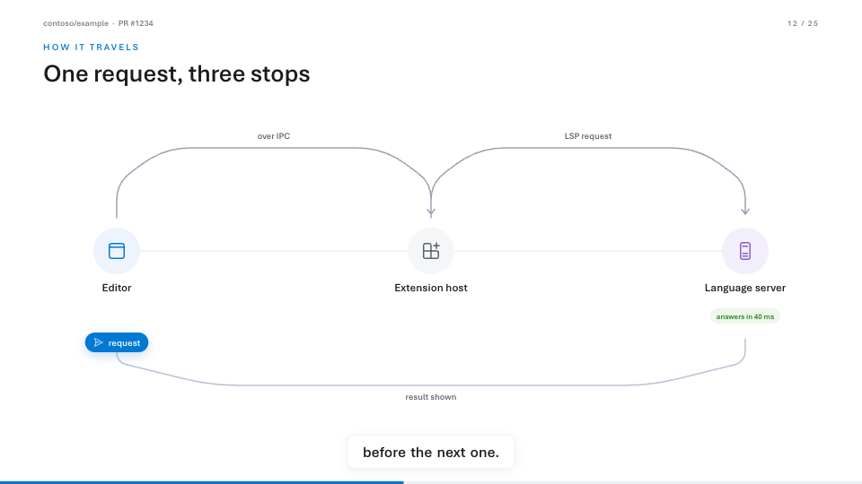

| param | what |
| --- | --- |
| `eyebrow` | label |
| `title` | label |
| `packet` | { text, icon, tone }  (what travels) |
| `nodes` | [{ id, icon, title, sub, tone }]  (3-5, left to right) |
| `hops` | [{ from, to, label, result, resultTone, at }]  (each a curve between two nodes; result shows on the arrival node) |

### `exchange.lifelines`: Sequence diagram

A protocol or handshake with 2-4 parties and 2-5 ordered messages; best when the order of calls is the point.

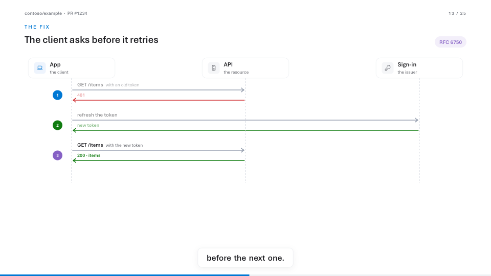

| param | what |
| --- | --- |
| `eyebrow` | label |
| `title` | label |
| `tag` | label (e.g. the spec name) |
| `tagAt` | time |
| `parties` | [{ id, icon, title, sub, tone }]  (2-4, left to right) |
| `steps` | [{ from, to, request, requestSub, mono, reply, replyTone, at, replyAt, badgeAt }]  (2-5) |
| `skip` | { at, note, from: stepNumber (default 2), alt: { step, text } }  (optional: later steps are conditional) |
| `code` | { block: code(...), title, rows (default 3), steps: [{ at, from, to }] }  (optional) |

## flow: steps in order: a pipeline, a process, a branch

### `flow.numbered`: Numbered steps

3-6 steps with a sentence each, where reading order matters more than a picture of the flow.

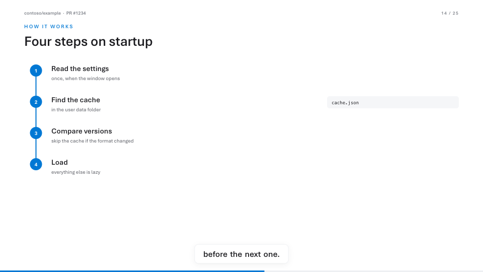

| param | what |
| --- | --- |
| `eyebrow` | label |
| `title` | label |
| `steps` | [{ title, text, code, at }]  (2-6) |

### `flow.pipeline`: Pipeline

2-5 steps that run in order (a build, a request path, a migration), optionally with one branch.

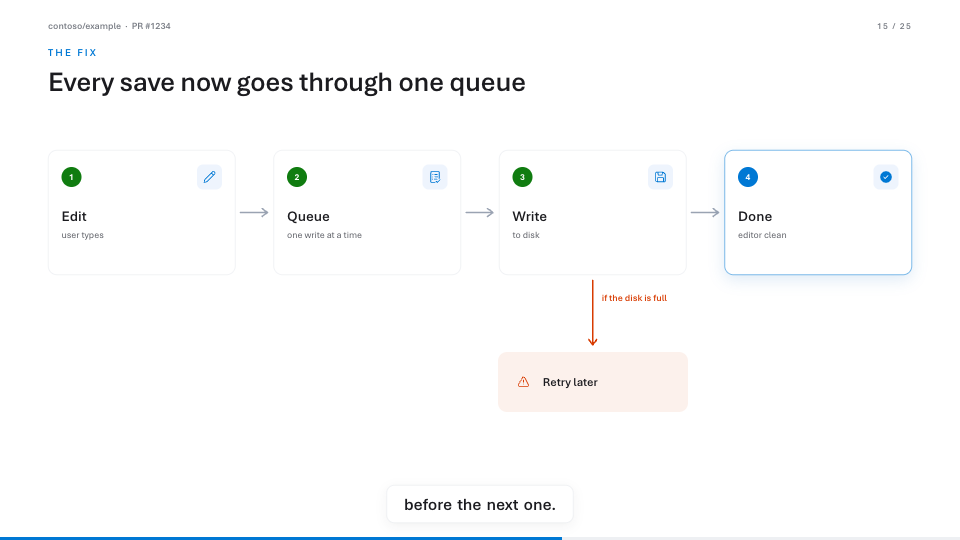

| param | what |
| --- | --- |
| `eyebrow` | label |
| `title` | label |
| `stages` | [{ icon, title, sub, code, tone, at }]  (2-5) |
| `branch` | { from: stage number, label, title, sub, tone, icon, at }  (optional) |

## rules: a rule applied to cases: validation, filtering, permissions

### `rules.matrix`: Comparison matrix

A rule that compares several fields of each case against a reference (origin, version, scope). Cases come from the PR’s tests.

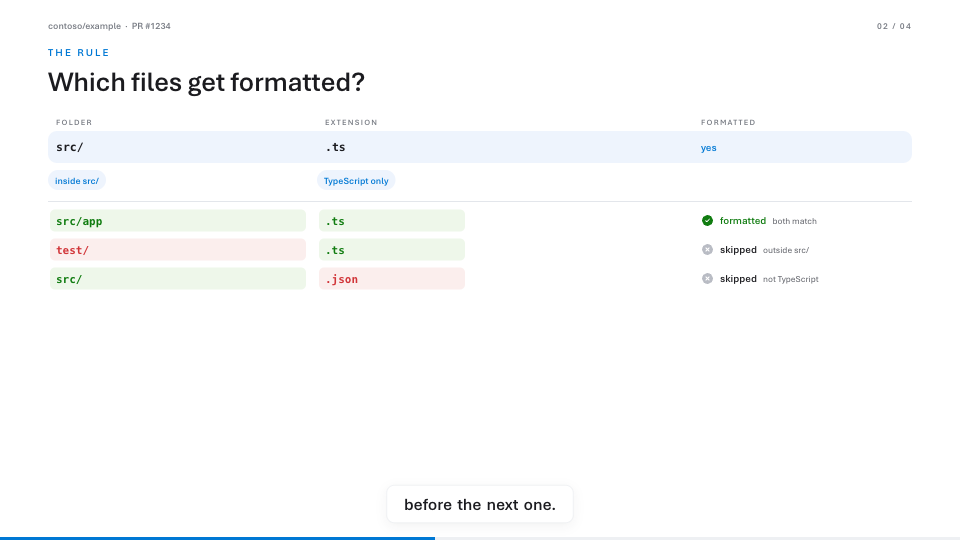

| param | what |
| --- | --- |
| `eyebrow` | label |
| `title` | label |
| `tag` | text (e.g. the function) |
| `tagAt` | time |
| `tagMono` | bool |
| `columns` | [{ id, label, width }]  (2-4 data columns; widths in px, total about 1290) |
| `verdictLabel` | label for the verdict column |
| `reference` | { cells: { [column]: text }, verdict: text } |
| `rules` | [{ column, text, tone, at }] |
| `rows` | [{ cells: { [column]: text }, pass: { [column]: bool }, ok, verdict, why, at } \| { whole: text, ok, verdict, why, at }] |
| `code` | { block: code(...), title, note, rows }  (optional) |

### `rules.sieve`: Gates

A series of checks that filter cases (2-3 gates, 2-5 cases): which ones make it through, and where the others stop.

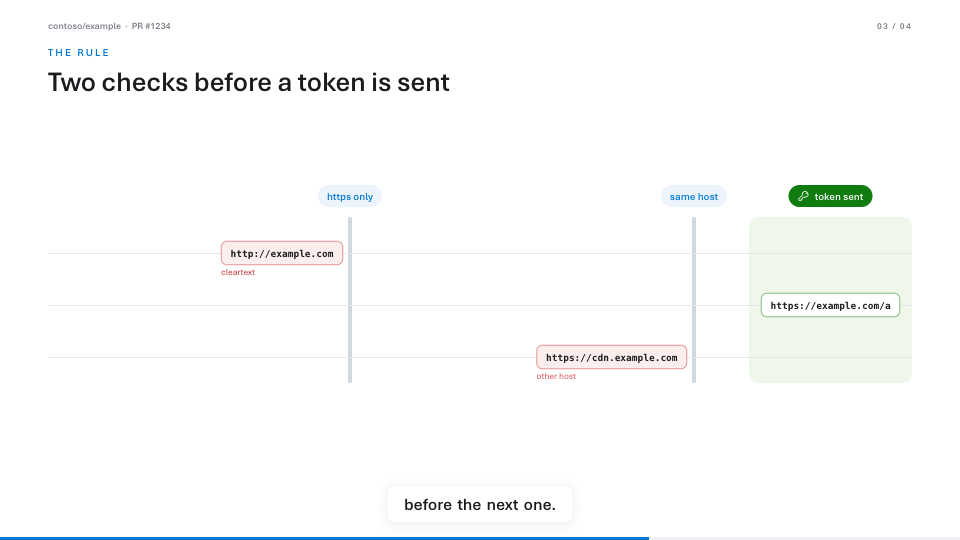

| param | what |
| --- | --- |
| `eyebrow` | label |
| `title` | label |
| `gates` | [{ label, sub }]  (2-3, in order) |
| `pass` | { label, icon }  (the zone for cases that pass every gate) |
| `cases` | [{ text, mono, stopsAt: gate number (1-based) or null when it passes, why, at }]  (2-5) |

### `rules.stamps`: Verdict stamps

A rule shown through 3-6 concrete cases that each get a clear yes or no.

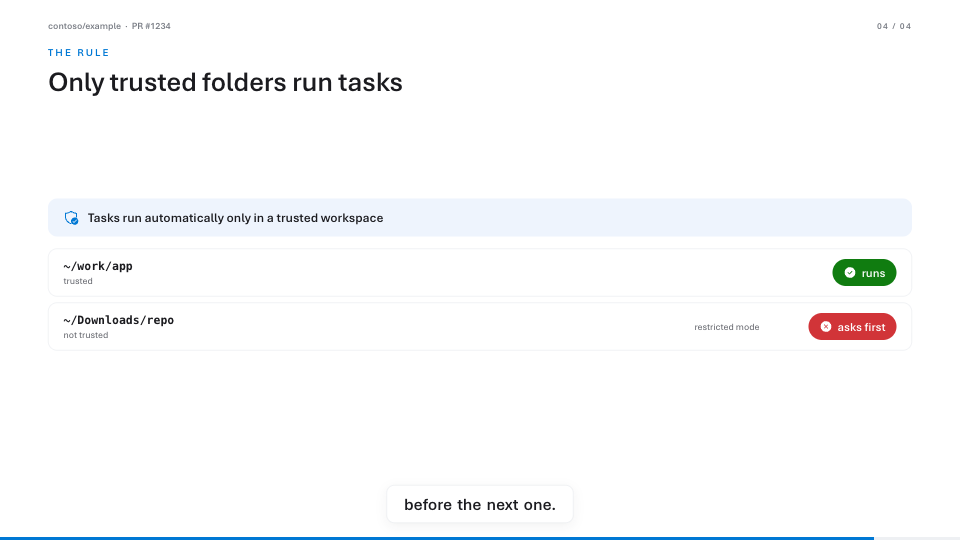

| param | what |
| --- | --- |
| `eyebrow` | label |
| `title` | label |
| `rule` | { icon, text, at }  (the rule in one line) |
| `cases` | [{ text, mono, sub, ok, verdict, why, at }]  (2-6) |

## compare: behavior before and after the change

### `compare.split`: Before and after

Behavior that differs on 2-5 aspects (what the user sees, what is sent, what is cached).

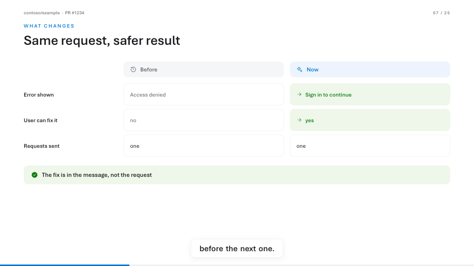

| param | what |
| --- | --- |
| `eyebrow` | label |
| `title` | label |
| `before` | { title, icon } |
| `after` | { title, icon } |
| `rows` | [{ aspect, before, after, changed (default true), mono, at }]  (1-5) |
| `takeaway` | { text, tone, at }  (optional) |

### `compare.wipe`: Wipe reveal

One screen, list or result that looks different after the change; the viewer sees it flip in place.

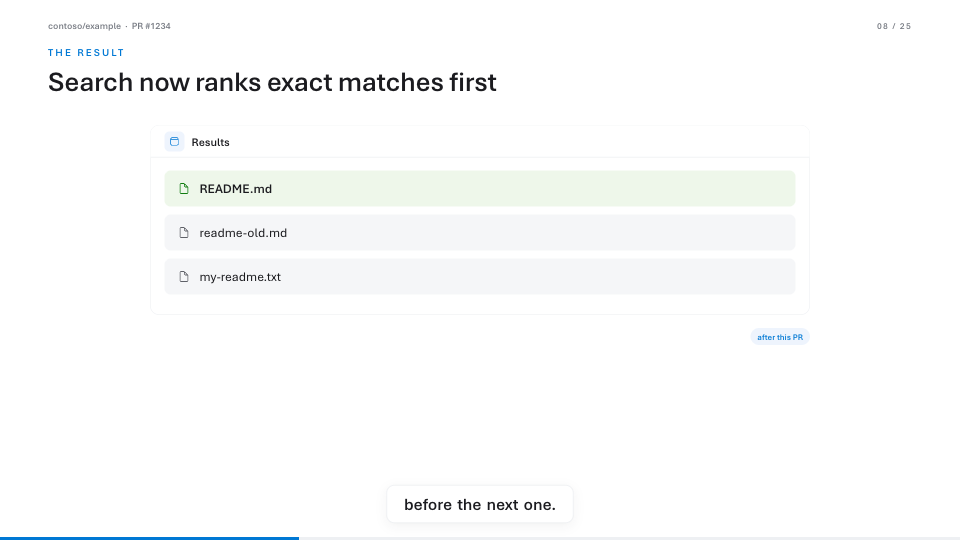

| param | what |
| --- | --- |
| `eyebrow` | label |
| `title` | label |
| `before` | { title, icon, items: [{ icon, text, tone, mono }] }  (2-5 items) |
| `after` | { title, icon, items: [...] } |
| `at` | time of the wipe |
| `note` | { before, after }  (labels under the panel) |

## architecture: where the change reaches: components, processes, layers

### `architecture.layers`: Layer stack

The change sits at some levels of a layered system (for VS Code: base, platform, editor, workbench, extensions). Shows which layers move and how a call crosses them.

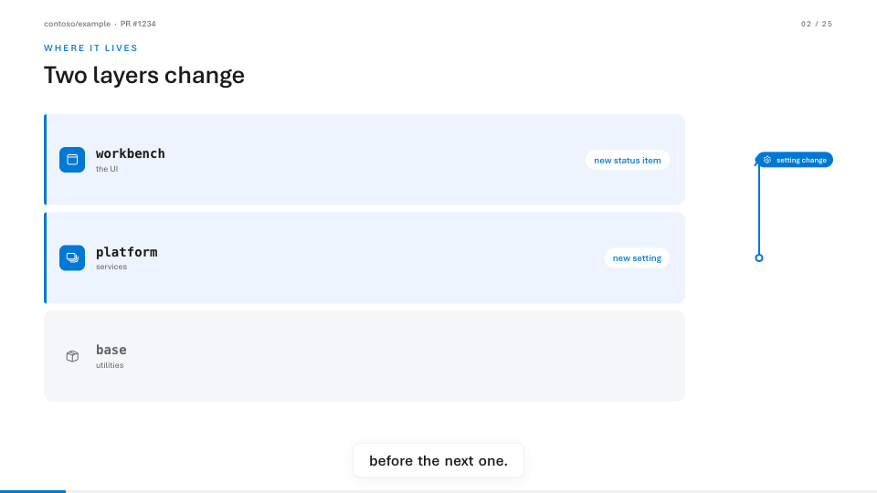

| param | what |
| --- | --- |
| `eyebrow` | label |
| `title` | label |
| `layers` | [{ title, sub, icon, touched, note, at }]  (3-6, top to bottom; note = what changes there) |
| `path` | { text, icon, through: [layer numbers, 1-based], at }  (optional: a marker travels through these layers) |

### `architecture.map`: Reach map

Something (a token, a setting, a cache) now flows to several request types or processes. Shows every place it reaches.

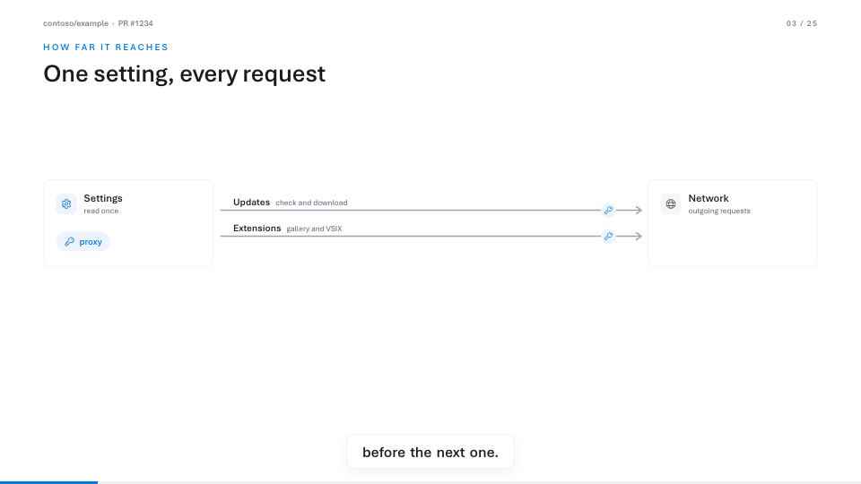

| param | what |
| --- | --- |
| `eyebrow` | label |
| `title` | label |
| `source` | { icon, title, sub, tone, chip: { icon, text } } |
| `target` | { icon, title, sub, tone } |
| `lanes` | [{ title, sub, at, key: bool }]  (1-4 labeled arrows from source to target) |
| `branch` | { label, sub, at, nodes: [{ icon, title, sub, tone, at }] }  (optional, 1-3 nodes) |
| `aside` | { label, at, rows: [{ lead, value, text, tone, strikeAt }] }  (optional, 1-2 rows) |

### `architecture.zones`: Process zones

The change spans processes, machines or owners, and what crosses the boundary (IPC, a protocol, a file) is the point.

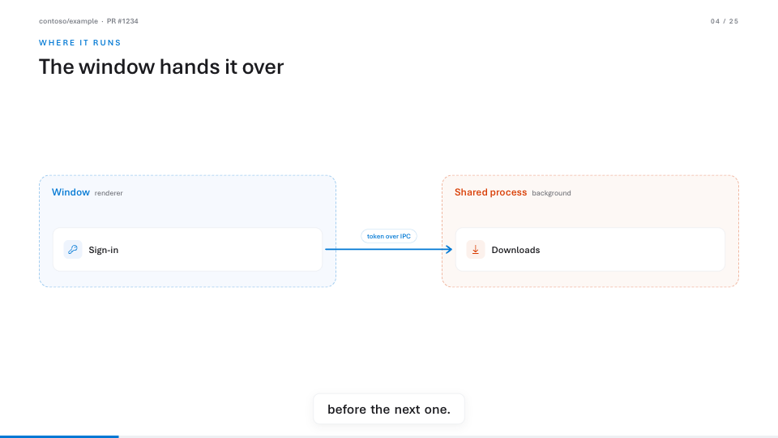

| param | what |
| --- | --- |
| `eyebrow` | label |
| `title` | label |
| `zones` | [{ title, sub, tone, items: [{ id, icon, title, sub, at }] }]  (2-3 zones, 1-3 items each) |
| `links` | [{ from: itemId, to: itemId, label, mono, at, tone }]  (0-4) |

## code: the code itself: the key lines, a diff, old next to new

### `code.diff`: Diff with callouts

The change is small and the exact lines tell the story (a condition flipped, a guard added, a value changed). Up to ~18 diff lines.

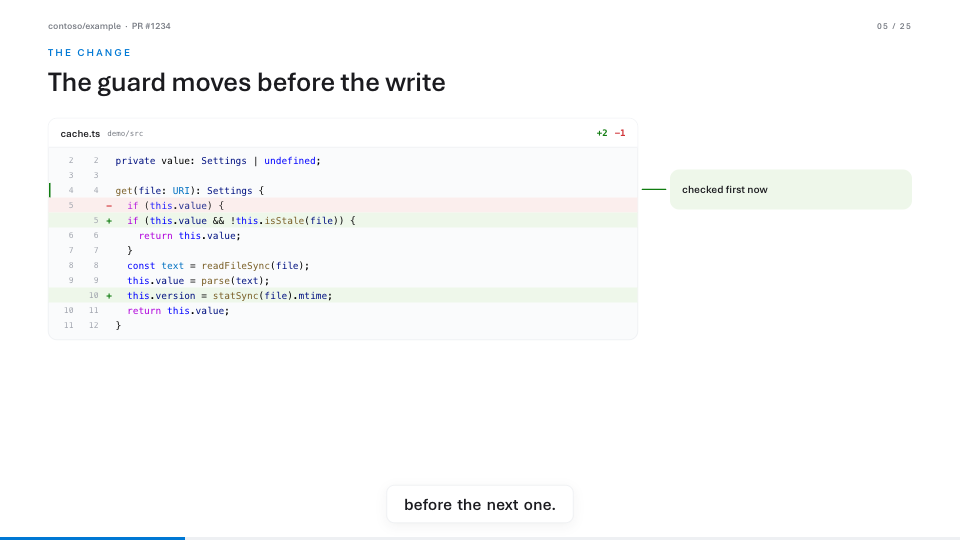

| param | what |
| --- | --- |
| `eyebrow` | label |
| `title` | label |
| `hunk` | code(file, { diff: true, anchor })  (optionally from/to to trim) |
| `callouts` | [{ line: line number (new, or old for a removed line), text, tone, at }]  (1-4) |

### `code.walkthrough`: Code walkthrough

One function (up to ~30 lines) is the heart of the PR; 2-4 notes explain its parts in order.

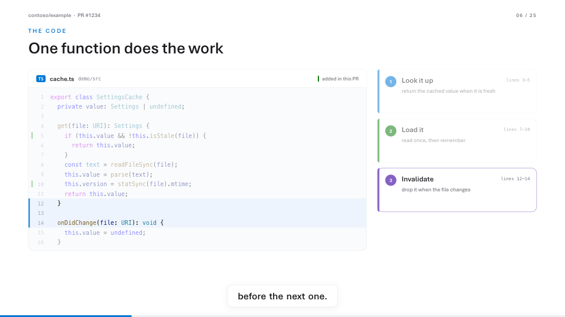

| param | what |
| --- | --- |
| `eyebrow` | label |
| `title` | label |
| `block` | code(file, { from, to }) or code(file, { anchor, block: true }) |
| `notes` | [{ lines: [from, to], title, text, at }]  (2-4) |

## numbers: sizes and counts: files, lines, measurements

### `numbers.counters`: Big numbers

A few numbers carry the point (lines removed, ms saved, files touched). Each value comes from fact() or quote().

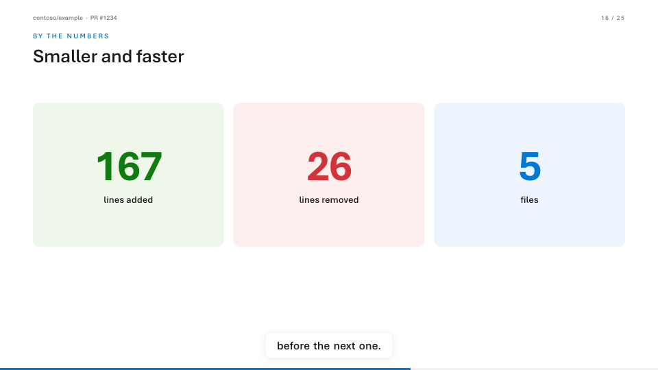

| param | what |
| --- | --- |
| `eyebrow` | label |
| `title` | label |
| `stats` | [{ value: fact()\|quote(), label, sub, tone, at }]  (2-4) |
| `note` | label (optional line under the tiles) |

### `numbers.treemap`: Treemap of the change

A big or cross-cutting PR: show which areas carry most of the change (data comes from the PR, nothing to type).

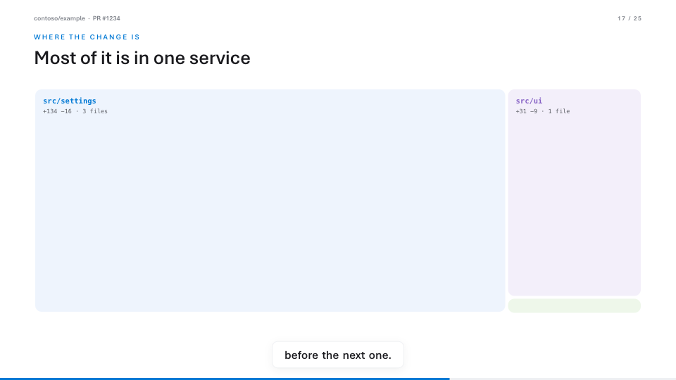

| param | what |
| --- | --- |
| `eyebrow` | label |
| `title` | label |
| `highlight` | [{ area, note, at }]  (optional: areas to call out) |

## state: states and transitions: a lifecycle, a state machine

### `state.track`: State track

Something moves through 3-5 states (signed out -> negotiating -> authorized; queued -> running -> done), maybe with a failure state.

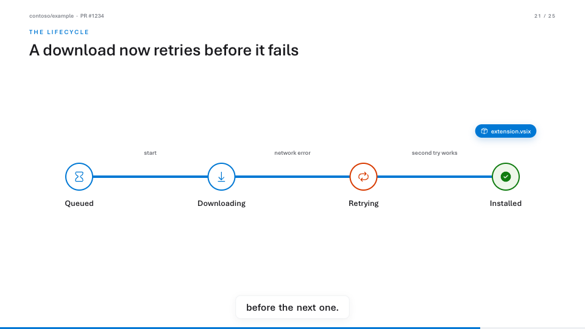

| param | what |
| --- | --- |
| `eyebrow` | label |
| `title` | label |
| `states` | [{ title, sub, icon, tone, at }]  (3-5, in order) |
| `edges` | [{ label }]  (labels of the transitions between consecutive states; optional) |
| `marker` | { text, icon }  (what moves) |
| `fail` | { from: state number, title, sub, at }  (optional dead end below a state) |

## ui: something the user sees: a UI element, a message, a setting

### `ui.toasts`: Notification before and after

The PR changes a message, error or prompt the user sees (and maybe what they can do about it).

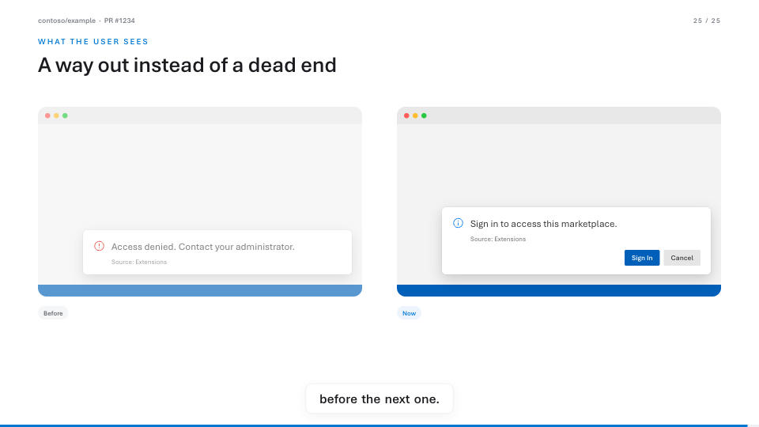

| param | what |
| --- | --- |
| `eyebrow` | label |
| `title` | label |
| `before` | { severity: error\|warning\|info, message, source, actions: [labels], caption, at } |
| `after` | { severity, message, source, actions, caption, at } |

## status: scope, tests and what is still open

### `status.board`: Now, next, later

The closing beat when the PR is one step of a larger plan: what lands now, what follows, what is open.

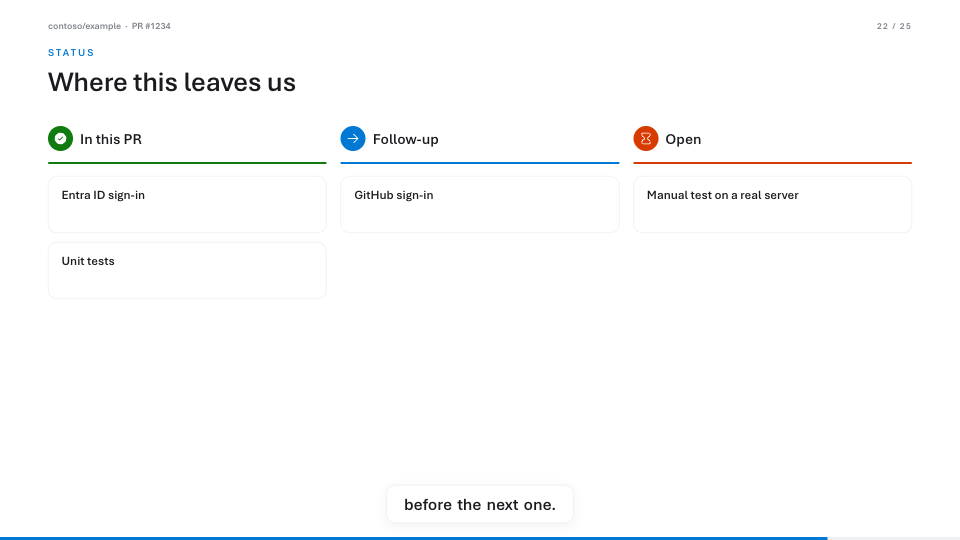

| param | what |
| --- | --- |
| `eyebrow` | label |
| `title` | label |
| `columns` | [{ title, tone, icon, items: [{ text, sub, at }] }]  (2-3 columns, 1-4 items each) |

### `status.checklist`: Checklist + start here

The closing beat: what is in scope, what is left for later, how it is tested, and the 1-3 places to read first.

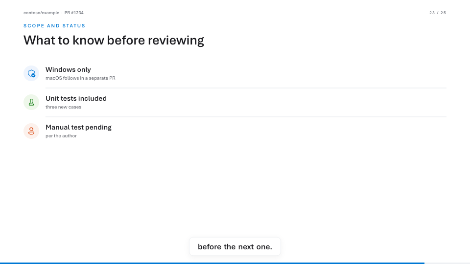

| param | what |
| --- | --- |
| `eyebrow` | label |
| `title` | label |
| `items` | [{ icon, tone, title, sub, at }]  (2-5) |
| `read` | { label, refs: [{ code: code(file, { anchor }), title, what, at }] }  (optional, 1-3) |
