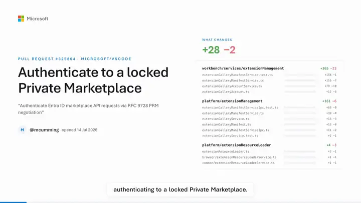
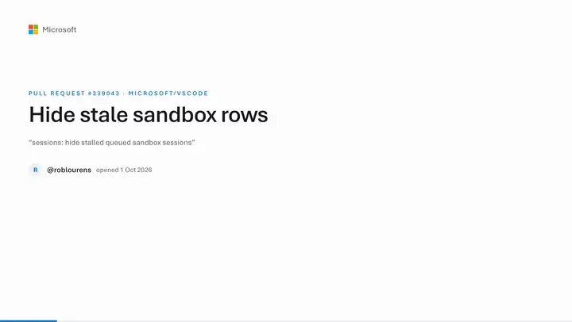
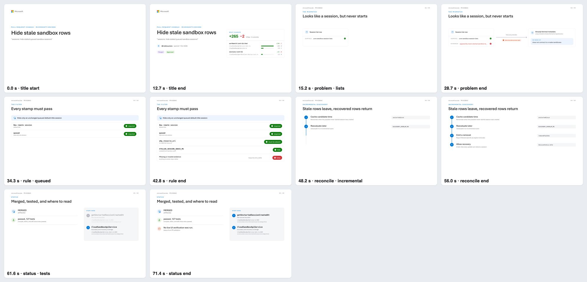
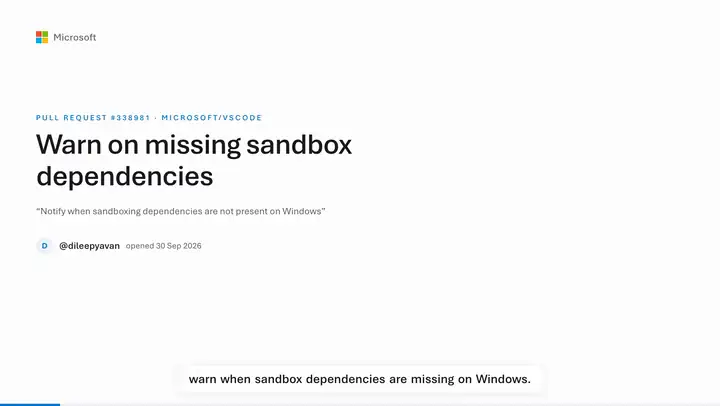
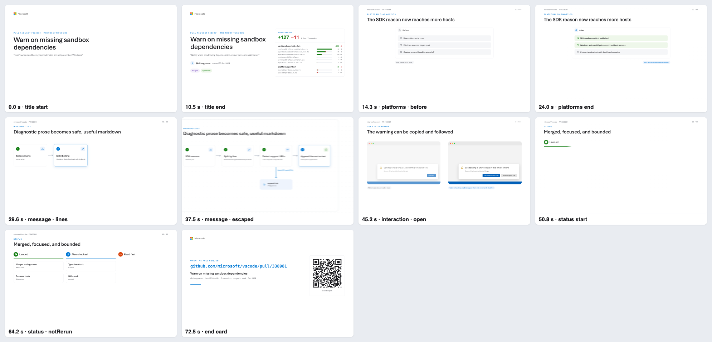
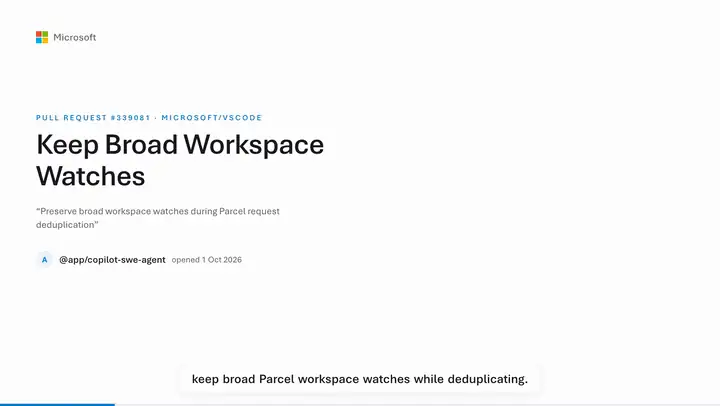
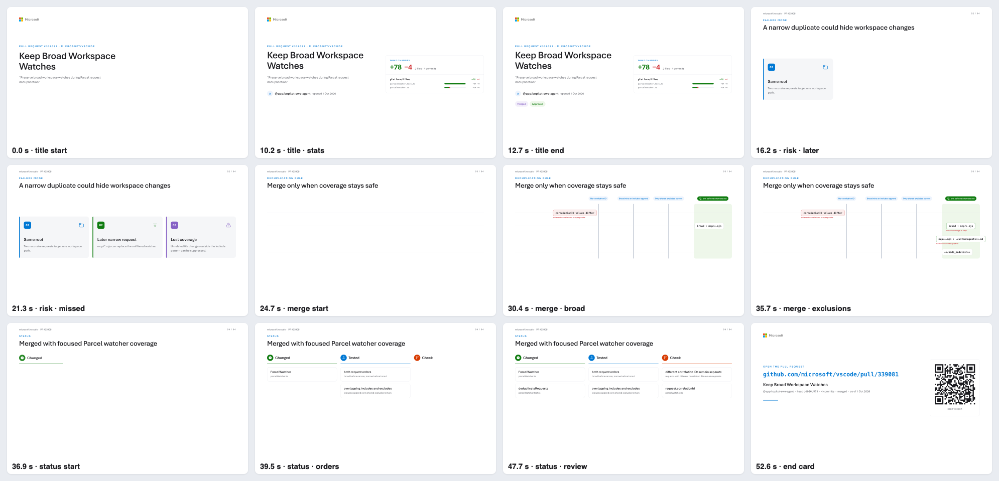
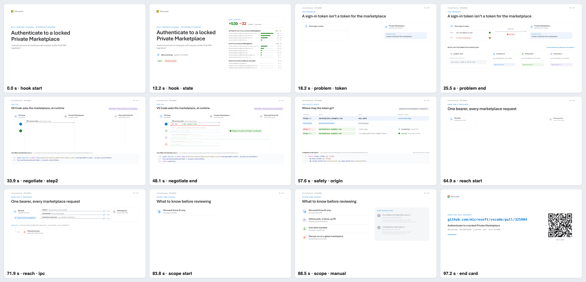
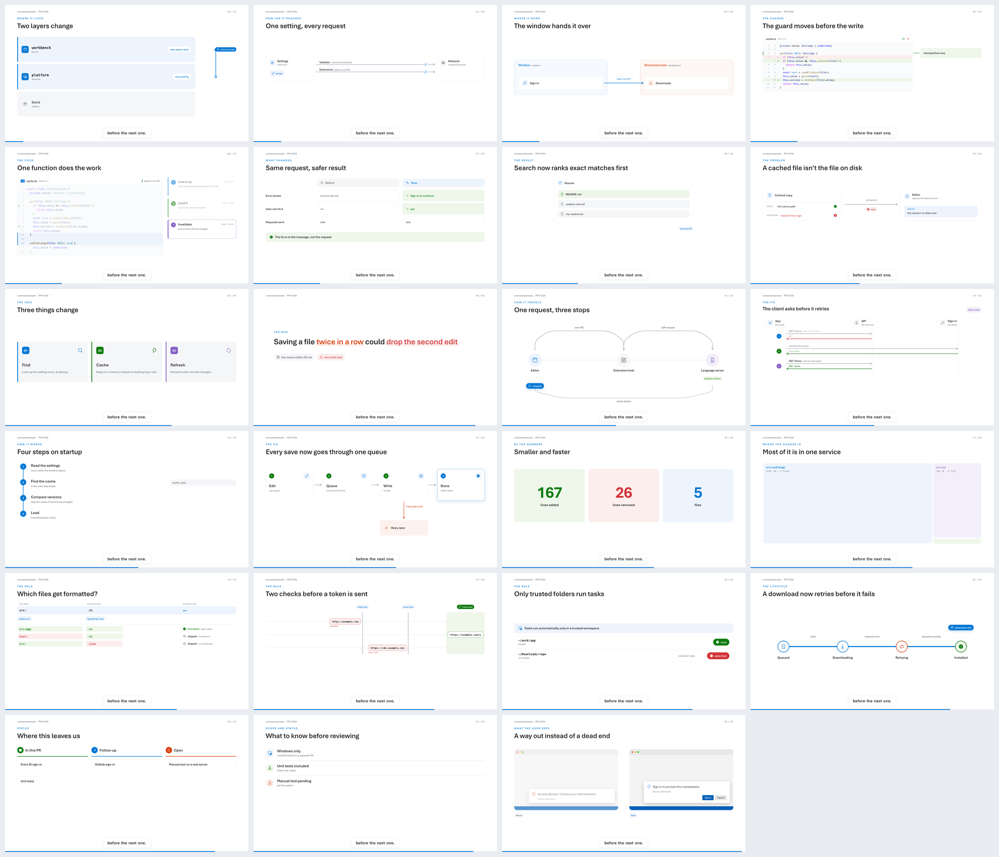

# pr-studio

Give an agent a pull request URL, get a short video that explains it: what changes, why, how it works, the risk,
the status, and where to start reading. 40-100 seconds, narrated, captioned, in one consistent white Microsoft look,
with diagrams chosen for each PR.

<a href="https://github.com/federicobrancasi/pr-studio/releases/download/gallery/microsoft-vscode-325804.mp4"></a>

<sub>**[▶ Watch the full video](https://github.com/federicobrancasi/pr-studio/releases/download/gallery/microsoft-vscode-325804.mp4)** (1:39) for [microsoft/vscode#325804](https://github.com/microsoft/vscode/pull/325804). The preview above plays a moment of each beat.</sub>

## Quickstart

```sh
git clone https://github.com/federicobrancasi/pr-studio && cd pr-studio
npm install
node cli/prs.mjs doctor          # browser, voice model, Whisper, ffmpeg
```

Open the folder in Visual Studio Code (Copilot agent mode), the Copilot CLI or Claude Code and ask:
**"Make a video for https://github.com/microsoft/vscode/pull/325804"**. The `pr-video` skill and the
`pr-director` reviewer load from [`.claude/`](.claude/).

## How it works

1. `prs new <PR>` fetches the PR and writes a one-page `brief.md` and a storyboard skeleton sized to the PR.
2. The agent writes the narration (`storyboard.json`): one idea per beat, cues, and evidence for every claim.
3. `prs voice` makes the narration (MAI-Voice-2 with an Azure key, otherwise the offline Kokoro voice) and times
   every word with Whisper, snapped to the real pauses.
4. `prs direct` picks a diagram for each beat from the [catalog](.claude/skills/pr-video/catalog.md) and a motion
   (slides, or a camera flying over a board), weighted away from what recent videos used, and scaffolds `scenes.js`.
5. The agent fills in the content. Every string on screen declares where it comes from (`label`, `fact`, `quote`,
   `ident`, `path`, `code`) and is verified against the PR's head commit.
6. `prs lint` checks every frame (overflow, clipping, collisions, provenance, caption band, QR, novelty);
   `prs render` and `prs publish` encode, run the sync gate and deliver to `~/Downloads/pr-videos/`.
7. The `pr-director` agent reviews accuracy, clarity, craft, sync and novelty and signs the video off.

Rendering is fast: frames are a pure function of time, captured by several browser processes, cached by content
(unchanged frames are reused), with captions composited by ffmpeg. A 100-second video renders in about 12 seconds
and encodes in 6 on an M-series Mac.

## From Slack

Mention **@GitHub** in Slack and a Copilot cloud session makes the videos and posts them in the thread:

| Ask | You get |
| --- | --- |
| `@GitHub videos for today's changelog <link to the #changelog message>` | the plan (which PRs get a video, which are faster to read, with the changed line quoted), then up to 3 videos as each is ready, then a summary |
| `@GitHub video 339632`, or PR links | a video for each |
| `@GitHub video anyway 339518` | a video even for a PR the triage says is faster to read |

`prs triage` decides: a PR with no source change, a revert or version bump, or at most 25 source lines in 1-2 files
is faster to read than to watch. In the cloud a video takes 15-20 minutes, the reviewer's sign-off included, so a
changelog request makes up to 3 and lists the rest for another day (`video <number>` makes one of those). The session follows [guides/slack.md](.claude/skills/pr-video/guides/slack.md) in
the environment from [copilot-setup-steps.yml](.github/workflows/copilot-setup-steps.yml): Linux, 2 cores, the
Kokoro voice, 59 minutes per session. Run that workflow by hand to check the cloud machine: it makes a short smoke
video and uploads it with the time of each step.

Setup, once:

1. In Slack, invite @GitHub to a private channel (for example `#pr-videos`), sign in to GitHub from it, and set
   `federicobrancasi/pr-studio` as the channel's default repository in the app's settings.
2. In the repository's **Settings → Copilot → Internet access**, add the custom allowlist rule
   `https://api.github.com/repos/`. The agent's firewall blocks the GitHub API, and the CLI reads the PRs from
   there (without a token: public data only). Diffs and files come from `*.githubusercontent.com`, already allowed.
3. Optional, in **Settings → Secrets and variables → Agents**:
   - `PRS_GITHUB_TOKEN`, a read-only token, when a changelog needs more than 60 GitHub API calls an hour.
   - `AZURE_SPEECH_KEY` for the MAI-Voice-2 voice instead of Kokoro (also add the rule
     `eastus2.tts.speech.microsoft.com` to the allowlist).

Each session works on its own branch with a draft pull request (that's how cloud sessions work) and commits only
the history of the videos it made. The [tidy workflow](.github/workflows/tidy-sessions.yml) copies that history to
main every day, so tomorrow's videos pick different diagrams, and closes the drafts after two days.

## Gallery

Each video gets its own diagrams. The last three were made by fresh agents with only the skill and signed off by the
`pr-director` reviewer; after the fixes from the first two, the third took about 5 minutes and passed the sync gate
on its first publish. Previews play inline; **Watch** opens the full video with sound.

<!-- gallery:start (generated by prs gallery) -->
<table>
<tr>
<td width="55%" valign="top">

<a href="https://github.com/federicobrancasi/pr-studio/releases/download/gallery/microsoft-vscode-339043.mp4"></a>

</td>
<td valign="top">

**Hide stale sandbox rows**<br>
[microsoft/vscode#339043](https://github.com/microsoft/vscode/pull/339043) · 1:15 · slides

<sub>Have vs need → Verdict stamps → Numbered steps → Checklist + start here</sub>

**[▶ Watch the video](https://github.com/federicobrancasi/pr-studio/releases/download/gallery/microsoft-vscode-339043.mp4)** <sub>(2.7 MB)</sub><br>
<sub>[captions](https://github.com/federicobrancasi/pr-studio/releases/download/gallery/microsoft-vscode-339043.srt) · [frames](gallery/microsoft-vscode-339043/contact.png)</sub>

</td>
</tr>
<tr>
<td colspan="2">
<details>
<summary>Every beat, frame by frame</summary>



</details>
</td>
</tr>
<tr>
<td width="55%" valign="top">

<a href="https://github.com/federicobrancasi/pr-studio/releases/download/gallery/microsoft-vscode-338981.mp4"></a>

</td>
<td valign="top">

**Warn on missing sandbox dependencies**<br>
[microsoft/vscode#338981](https://github.com/microsoft/vscode/pull/338981) · 1:14 · camera over a board

<sub>Wipe reveal → Pipeline → Notification before and after → Now, next, later</sub>

**[▶ Watch the video](https://github.com/federicobrancasi/pr-studio/releases/download/gallery/microsoft-vscode-338981.mp4)** <sub>(3.3 MB)</sub><br>
<sub>[captions](https://github.com/federicobrancasi/pr-studio/releases/download/gallery/microsoft-vscode-338981.srt) · [frames](gallery/microsoft-vscode-338981/contact.png)</sub>

</td>
</tr>
<tr>
<td colspan="2">
<details>
<summary>Every beat, frame by frame</summary>



</details>
</td>
</tr>
<tr>
<td width="55%" valign="top">

<a href="https://github.com/federicobrancasi/pr-studio/releases/download/gallery/microsoft-vscode-339081.mp4"></a>

</td>
<td valign="top">

**Keep Broad Workspace Watches**<br>
[microsoft/vscode#339081](https://github.com/microsoft/vscode/pull/339081) · 0:54 · slides

<sub>Numbered pillars → Gates → Now, next, later</sub>

**[▶ Watch the video](https://github.com/federicobrancasi/pr-studio/releases/download/gallery/microsoft-vscode-339081.mp4)** <sub>(2 MB)</sub><br>
<sub>[captions](https://github.com/federicobrancasi/pr-studio/releases/download/gallery/microsoft-vscode-339081.srt) · [frames](gallery/microsoft-vscode-339081/contact.png)</sub>

</td>
</tr>
<tr>
<td colspan="2">
<details>
<summary>Every beat, frame by frame</summary>



</details>
</td>
</tr>
<tr>
<td width="55%" valign="top">

<a href="https://github.com/federicobrancasi/pr-studio/releases/download/gallery/microsoft-vscode-325804.mp4"></a>

</td>
<td valign="top">

**Authenticate to a locked Private Marketplace**<br>
[microsoft/vscode#325804](https://github.com/microsoft/vscode/pull/325804) · 1:39 · slides

<sub>Have vs need → Sequence diagram → Comparison matrix → Reach map → Checklist + start here</sub>

**[▶ Watch the video](https://github.com/federicobrancasi/pr-studio/releases/download/gallery/microsoft-vscode-325804.mp4)** <sub>(4.2 MB)</sub><br>
<sub>[captions](https://github.com/federicobrancasi/pr-studio/releases/download/gallery/microsoft-vscode-325804.srt) · [frames](gallery/microsoft-vscode-325804/contact.png)</sub>

</td>
</tr>
<tr>
<td colspan="2">
<details>
<summary>Every beat, frame by frame</summary>



</details>
</td>
</tr>
</table>
<!-- gallery:end -->

The full videos live in the [`gallery` release](https://github.com/federicobrancasi/pr-studio/releases/tag/gallery),
not in git, so cloning stays fast for people and agents. Agents never need them: they work from the catalog, and the
reviewer compares contact sheets.

## The diagram catalog

24 treatments for 12 kinds of explanation, all in the same look. [`catalog.md`](.claude/skills/pr-video/catalog.md)
has a still and the parameters of each.



## Commands

`node cli/prs.mjs help` lists them: `doctor`, `triage`, `summary`, `new`, `check`, `voice`, `direct`, `prepare`,
`stills`, `lint`, `draft`, `render`, `publish`, `concepts`, `catalog`, `history`, `gallery`, `report`, `smoke`.

## License

MIT ([LICENSE](LICENSE)). Third-party software, models and fonts: [NOTICE](NOTICE).
